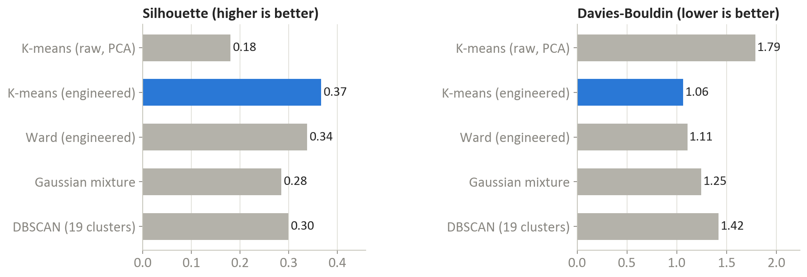
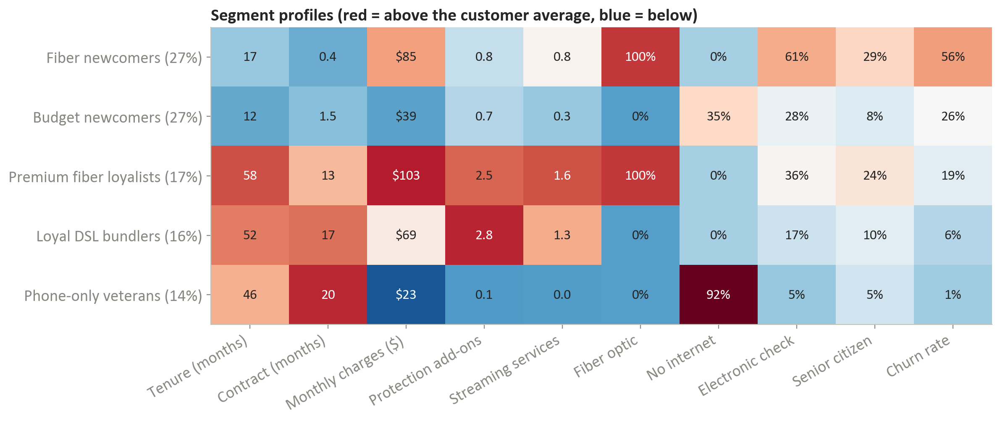

# Customer segmentation with K-means: five telco segments and where the churned revenue sits

An unsupervised-learning project on the IBM Telco Customer Churn dataset (7,043 customers). Two candidate feature sets and five clustering variations are compared with silhouette, Davies–Bouldin, Calinski–Harabasz and bootstrap stability; the recommended model is K-means with k = 5 on six engineered behavioural features. One segment, "fibre newcomers", holds 27% of customers and 65% of the churned revenue.

Final project for *Unsupervised Machine Learning* (IBM Machine Learning Professional Certificate, October 2026).

| | |
|---|---|
| Notebook | [`Unsupervised ML - Customer Segmentation.ipynb`](Unsupervised%20ML%20-%20Customer%20Segmentation.ipynb) |
| Report (10 pages) | [`report/Unsupervised ML - Final Project Report.pdf`](report/Unsupervised%20ML%20-%20Final%20Project%20Report.pdf) |
| Data | `data/Telco-Customer-Churn.csv` (IBM sample dataset, included) |
| Outputs | `figures/` (6 charts), `results/` (every table in the report as CSV) |

## Results

### Feature engineering beats raw flags

| Feature set | PCA components needed | Silhouette at k = 5 |
|---|---|---|
| 18 raw service flags, via PCA | 10 components for 80% of the variance | 0.18 |
| **6 engineered behavioural features** | **3 components for 87%** | **0.37** |

The six features are tenure, contract length in months, monthly charges, number of protection services, number of streaming services and a fibre flag. The first three principal components read as *spend and service depth*, *commitment* (tenure and contract) and *fibre vs. protection*.

### Five model variations, same k = 5

| Model | Silhouette | Davies–Bouldin | Calinski–Harabasz | Stability (bootstrap ARI) |
|---|---|---|---|---|
| K-means, raw features via PCA | 0.18 | 1.79 | 1,235 | 0.99 |
| **K-means, engineered features** | **0.37** | **1.06** | **3,896** | **0.99** |
| Hierarchical (Ward), engineered | 0.34 | 1.11 | 3,449 | 0.79 |
| Gaussian mixture, engineered | 0.28 | 1.25 | 3,006 | 0.95 |
| DBSCAN, engineered (19 clusters, 1.3% noise) | 0.30 | 1.42 | 1,831 | – |



### The five segments

Churn ranges from 1.4% to 56% across segments, which is the point of the exercise: the segmentation separates risk without ever seeing the churn label.

| Segment | Customers | Profile | Churn | Share of churned revenue |
|---|---|---|---|---|
| Fibre newcomers | 1,909 (27%) | 17 months' tenure, month-to-month, all on fibre, $85/month, 61% pay by electronic cheque | 56% | 65% |
| Budget newcomers | 1,868 (27%) | 12 months, $39/month, a third without internet, few add-ons | 26% | 14% |
| Premium fibre loyalists | 1,184 (17%) | 58 months, annual contracts, fibre, $103/month, most add-ons | 19% | 17% |
| Loyal DSL bundlers | 1,128 (16%) | 52 months, the longest contracts, $69/month, protection bundles | 6% | 3% |
| Phone-only veterans | 954 (14%) | 46 months, no internet, $23/month | 1.4% | 0.2% |

Fibre newcomers are 27% of customers and 35% of revenue, but **65% of the revenue lost to churn**; that is where a retention budget goes first.



### Do per-segment churn models help?

An optional last step trains one churn classifier per segment and compares it with a single global model on the same test customers: global model AUC 0.843, one model per segment 0.843, global model plus a segment feature 0.844. Splitting the data five ways costs more in sample size than it gains in specificity, and the segment label on its own adds almost nothing a global model cannot learn from the same features.

## Method notes

- Same cleaning as the companion classification project; `MonthlyCharges` kept here because it is a behaviour, not a target leak.
- k chosen by the elbow, silhouette and Davies–Bouldin together (`results/k_selection.csv`): silhouette is flat from k = 3 to 5 on the engineered features, and k = 5 is where the segments become distinct in business terms.
- Stability is the adjusted Rand index between the reference fit and refits with different random seeds; a held-out 20% of customers assigned by a model fitted on the other 80% agrees with the full fit as well.
- Limitations: a point-in-time extract with no customer history; the engineered features embed judgement calls (which services count as "protection"); DBSCAN's small clusters are real sub-groups but too small to act on.

## Reproduce

```bash
pip install -r requirements.txt
jupyter notebook "Unsupervised ML - Customer Segmentation.ipynb"
```

The notebook writes `figures/` and `results/`; `report/source/build_report.py` builds the Word report from those CSVs and `export_pdf.ps1` exports it to PDF.

## Data

IBM Telco Customer Churn sample dataset, as distributed with the IBM Cognos Analytics samples and on Kaggle; redistributed here for reproducibility.
